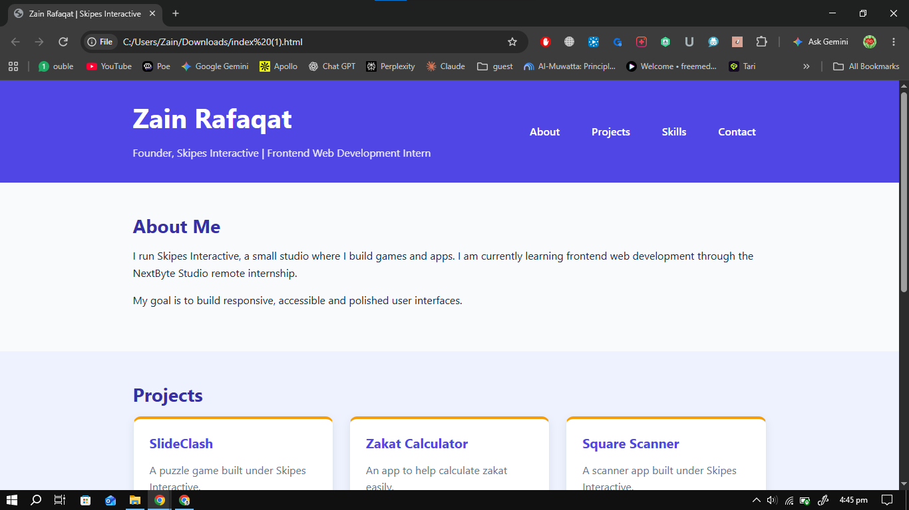
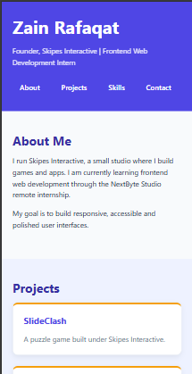

# NextByte Frontend Internship

Project repository for the **NextByte Studio Frontend Web Development** remote internship (8 weeks).

## Project Purpose

This repository contains my weekly work for the internship. The goal is to build responsive, accessible and polished user interfaces using HTML, CSS and JavaScript. The project grows week by week into a complete multi-page portfolio website.

## Week 1: Semantic HTML and Project Setup

- Created this GitHub repository
- Built a semantic multi-section page using `header`, `nav`, `main`, `section`, `article` and `footer`
- Added this README

## Week 2: CSS Foundations and Layout

- Added `style.css` and linked it in `index.html`
- **Color palette:** defined as CSS variables (primary indigo, amber accent, light background, dark text)
- **Typography:** one font stack with a consistent size scale for headings and body text
- **Spacing:** a spacing scale (`--space-1` to `--space-5`) used across the whole page
- **Reusable rules:** `.container`, `.card` and `.section` classes used in multiple places
- **Flexbox:** header layout, navigation links and the skills list
- **CSS Grid:** projects section using `repeat(auto-fit, minmax(220px, 1fr))`

### Page Structure

| Element | Purpose |
|---------|---------|
| `header` | Name, tagline and navigation (Flexbox) |
| `nav` | Links to page sections |
| `main` | Main content |
| `section` | About, Projects (Grid), Skills (Flexbox), Contact |
| `footer` | Copyright information |

## Setup Steps

1. Clone the repository:
   ```bash
   git clone https://github.com/zain-rafaqat/nextbyte-frontend-internship.git
   ```
2. Open the folder:
   ```bash
   cd nextbyte-frontend-internship
   ```
3. Open `index.html` in any browser (double-click it, or use the VS Code Live Server extension).

No installation or build step is needed.

## Screenshots

### Week 1


### Week 2: Desktop


### Week 2: Mobile


## Folder Structure

```
nextbyte-frontend-internship/
├── index.html
├── style.css
├── README.md
└── screenshots/
    ├── week1-desktop.png
    ├── week2-desktop.png
    └── week2-mobile.png
```

## Tools Used

- HTML5
- CSS3 (Variables, Flexbox, Grid)
- Git and GitHub
- VS Code

## Progress

| Week | Topic | Status |
|------|-------|--------|
| 1 | Semantic HTML and Setup | Done |
| 2 | CSS Foundations and Layout | Done |
| 3 | Responsive Website | Pending |
| 4 | JavaScript Interactions | Pending |
| 5 | Multi-Page Website | Pending |
| 6 | Accessibility and Quality | Pending |
| 7 | Capstone Build | Pending |
| 8 | Final Polish and Presentation | Pending |

## Author

Zain Rafaqat, Skipes Interactive
